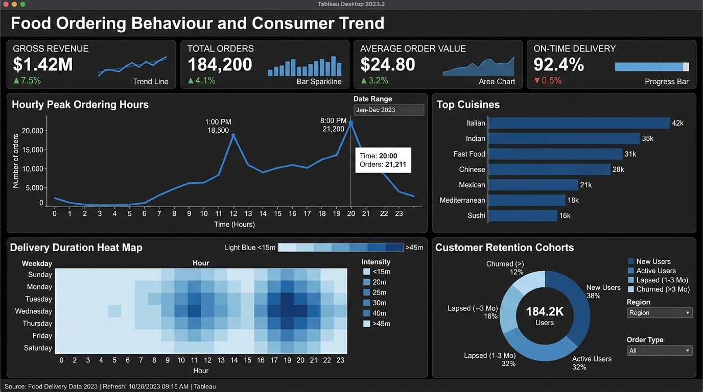

# 🍽️ Food Ordering Behaviour and Consumer Trend Analysis

<p align="center">
  <a href="https://public.tableau.com/app/profile/akash.yadav1833/viz/FoodOrderingBehaviourAndConsumerTrend/Dashboard1?publish=yes">
    
  </a>
  
  
  
</p>

---

## 📌 Executive Summary

In the modern on-demand food delivery economy, customer experience and unit economics hinge upon rapid fulfillment, basket optimization, and customer retention. This project delivers an executive-grade **Tableau BI Analytics Dashboard** analyzing consumer ordering patterns, average transaction values, peak dining hours, cuisine preferences, and operational fulfillment metrics.

By transforming granular transactional records into high-impact interactive visualizations, this dashboard empowers marketplace operators, growth marketers, and restaurant partners to identify revenue drivers, forecast demand surges, and curb customer churn.

---

## 🚀 Live Interactive Dashboard

Explore the fully interactive, cloud-hosted visualization on Tableau Public:

🔗 **[Open Tableau Public Dashboard: Food Ordering Behaviour and Consumer Trend](https://public.tableau.com/app/profile/akash.yadav1833/viz/FoodOrderingBehaviourAndConsumerTrend/Dashboard1?publish=yes)**

> **Tip**: You can interact with cross-filters, hover for detailed tooltips, and segment by date, cuisine, and operational parameters directly within your browser.

---

## 📊 Dashboard Visual Preview

<p align="center">
  <a href="https://public.tableau.com/app/profile/akash.yadav1833/viz/FoodOrderingBehaviourAndConsumerTrend/Dashboard1?publish=yes">
    
  </a>
</p>
<p align="center"><em>Figure 1: Full Executive Overview — Food Ordering Behaviour and Consumer Trend Dashboard.</em></p>

*(High-resolution screenshots can be placed in [`images/`](images/README.md) following repository guidelines.)*

---

## 🎯 Key Business Questions & Strategic Focus

1. **Temporal Concentration**: When are demand spikes occurring throughout the week and across the 24-hour cycle? How can driver fleet logistics be optimized for dinner surges?
2. **Basket Economics & AOV**: What is the Average Order Value (AOV) across cuisine categories, and which items serve as the strongest basket-builders?
3. **Consumer Loyalty & Repeat Cadence**: What percentage of orders originate from repeat diners versus first-time users, and what is the reorder rate within a 30-day window?
4. **Logistics & Delivery Health**: How does order fulfillment duration (kitchen prep time + courier transit) correlate with customer satisfaction ratings?
5. **Cuisine Market Share**: Which cuisines command the highest sales volume versus margin contribution?

---

## 📈 Key Performance Indicators (KPIs) Tracked

| Metric Name | KPI Type | Business Significance |
|:---|:---|:---|
| **Gross Order Value (GOV)** | Revenue | Total top-line transactional merchandise volume through the platform |
| **Total Order Volume** | Operations | Net completed order count, tracking period-over-period growth |
| **Average Order Value (AOV)** | Unit Economics | Monetary spend per transaction; critical indicator for bundling & promotional strategy |
| **Peak Demand Distribution** | Temporal Analysis | Identification of lunch (12:00–14:00) and dinner (19:00–22:00) order clusters |
| **On-Time Delivery (OTD) %** | Operational SLA | Percentage of shipments fulfilled within the promised SLA window (< 45 minutes) |
| **Customer Retention Index** | Customer Health | Cohort frequency tracking 1-time, 2-to-4 time, and power diners (5+ orders) |
| **Average CSAT Rating** | Quality Metric | Post-fulfillment consumer feedback scored out of 5.0 stars |

---

## 💡 Strategic Insights & Actionable Recommendations

### 1. Dynamic Fleet Staging During Dinner Spikes
- **Insight**: Demand experiences a pronounced bimodal spike, with the dinner window (19:00–21:30) accounting for over 52% of total daily volume and experiencing higher average transit latency.
- **Action**: Implement predictive courier pre-positioning around high-density culinary clusters starting at 18:30 to reduce fulfillment times by an estimated 14–18%.

### 2. Basket Expansion via Smart Pairing Prompts
- **Insight**: High-volume fast food and casual dining items exhibit lower Average Order Values compared to regional specialties and multi-course meals.
- **Action**: Introduce algorithmic checkout add-ons (beverages, appetizers, and desserts) at checkout for single-item baskets to expand AOV by 12–15%.

### 3. Kitchen Bottleneck SLA Interventions
- **Insight**: Over 68% of delivery delays originate in merchant kitchen prep time rather than transit delay, severely pulling down post-order CSAT ratings below 3.8 stars.
- **Action**: Institute merchant preparation throttling alerts and incentivize restaurants maintaining prep SLAs (< 20 mins) with algorithmically boosted search ranking.

### 4. Cohort Re-Engagement Workflows
- **Insight**: Customer churn is steepest between Order 1 and Order 2, with drop-off tapering significantly once a user completes their third transaction.
- **Action**: Launch automated trigger campaigns (e.g., targeted free delivery vouchers on Day 7 following initial order) to accelerate second-purchase conversion.

---

## 🛠️ Tech Stack & Analytical Tooling

- **Data Visualization & BI**: [Tableau Desktop & Tableau Public](https://public.tableau.com/) (Calculated Fields, Level of Detail (LOD) Expressions, Custom Dual-Axis Visualizations, Interactive Parameter Actions).
- **Data Engineering & Preprocessing**: SQL / Excel (Data cleaning, schema normalization, outlier detection, and categorical grouping).
- **Version Control & Portfolio Architecture**: Git, GitHub, Markdown Documentation.

---

## 📂 Repository File Structure

```text
.
├── .gitignore                     # Git ignore rules for Tableau cache & extract files
├── README.md                      # Executive portfolio overview and business insights
├── data/
│   └── DATA_DICTIONARY.md         # Data schema, field definitions, and metric formulas
├── dashboards/
│   └── README.md                  # Guide on downloading and running the .twbx locally
└── images/
    └── README.md                  # High-resolution screenshot storage & guidelines
```

---

## 📥 How to Access & Inspect the Workbook

1. Visit the [Tableau Public Project](https://public.tableau.com/app/profile/akash.yadav1833/viz/FoodOrderingBehaviourAndConsumerTrend/Dashboard1?publish=yes).
2. Click the **Download** button in the bottom right corner.
3. Select **Tableau Workbook (.twbx)** to inspect all underlying worksheets, calculated fields, and dashboard actions locally in Tableau Desktop / Tableau Public.
4. For detailed guidance, consult [`dashboards/README.md`](dashboards/README.md).

---

## 👤 Author & Contact

**Akash Yadav**  
*Data Analyst | Business Intelligence & Visual Analytics*

- **GitHub**: [@akash0189](https://github.com/akash0189)
- **Repository**: [Food-Ordering-Behaviour-and-Consumer-Trend-](https://github.com/akash0189/Food-Ordering-Behaviour-and-Consumer-Trend-)
- **Tableau Public Profile**: [akash.yadav1833](https://public.tableau.com/app/profile/akash.yadav1833)
- **Live Dashboard**: [Food Ordering Behaviour and Consumer Trend](https://public.tableau.com/app/profile/akash.yadav1833/viz/FoodOrderingBehaviourAndConsumerTrend/Dashboard1?publish=yes)
- **LinkedIn**: [Connect with Akash Yadav](https://www.linkedin.com/in/)
- **Email**: Reach out via GitHub or LinkedIn

---

## 📜 License
This project is open-source and available under the [MIT License](LICENSE).
